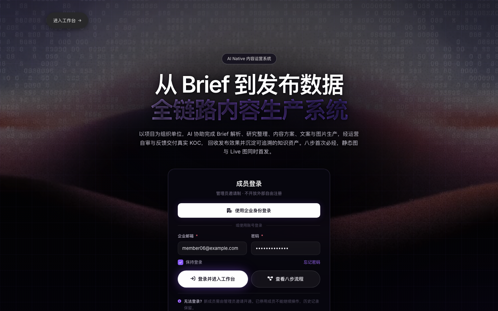
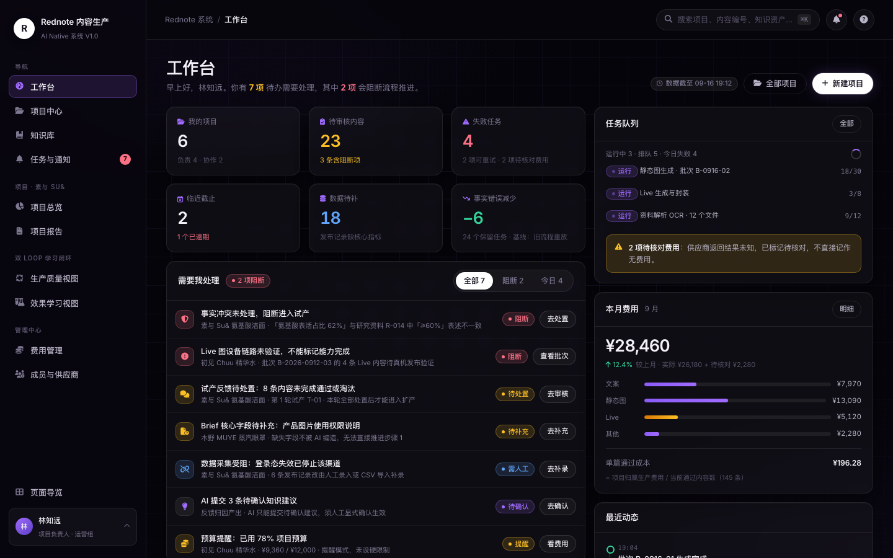
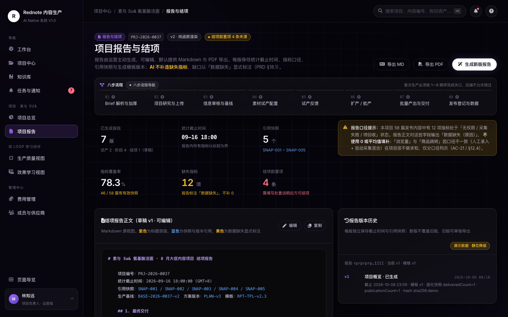

# Tuwen Content Studio

[](https://github.com/lbh-banboo/tuwen-content-studio/actions/workflows/ci.yml) · [中文](README.md)

[MIT](LICENSE) · `Python >= 3.12` · `FastAPI` · `PostgreSQL 17 + pgvector` · `v0.1.1`

Tuwen Content Studio（图文内容生产）is a public source snapshot of an AI-Native image-text content production system — a modular FastAPI backend plus a build-free interactive frontend prototype covering the full workflow from brief to published-content analytics.

> **中文**：本仓库是图文内容生产全流程 AI Native 系统的公开源码快照，含后端服务与可交互前端原型。

> **Snapshot notice**: This repository is a sanitized public source snapshot. It contains no original development history and no runtime data. All sample accounts, emails, paths, and domains are fictional; there are no real business records, credentials, browser profiles, or secrets.

## UI Preview

All data shown in the frontend prototype (`outputs/rednote-demo/`) is mock / synthetic:

**Sign-in and page guide**



**Workbench — projects, task queue, spend and activity at a glance**



**Project report and closure — eight-step flow view and report versioning**



## Project Status

**This is a work-in-progress research project, not a production-ready product.**

| Area | Status |
|---|---|
| Backend | Modular monolith: FastAPI + SQLAlchemy 2 + PostgreSQL 17/pgvector + Alembic. Delivered in milestones (M1–M5); some work packages still in development |
| Frontend | `outputs/rednote-demo/` is a static HTML/JS interactive prototype using mock / synthetic data |
| Deployment | The docker compose files under `deploy/dev/` have **not been verified on a developer machine** (no Docker locally); verify in a Docker-capable environment |
| External deps | Real platform adapters, Live environments, and OIDC/Keycloak are **unverified** or placeholder implementations; related outputs are marked `SYNTHETIC` / `PLACEHOLDER` |
| Tests | `services/backend/tests/` contains unit and integration tests; requires local PostgreSQL + pgvector |
| Docs | `docs/` holds ADRs and milestone notes; `docs/DEVELOPMENT-NOTES.md` is the original engineering log for design-tradeoff context |

Do not treat placeholder or unverified components as production-ready capabilities.

## Tech Stack

- Python >= 3.12, FastAPI 0.115 / SQLAlchemy 2.0 / psycopg 3 / Alembic 1.18
- PostgreSQL 17 + pgvector extension (migrations assert the `vector` extension is enabled)
- Events and tasks: outbox event table + task leases / idempotency records; the execution path does not depend on a message queue
- Optional infrastructure: MinIO (S3-compatible), RabbitMQ 4, Keycloak 26
- Frontend: build-free native HTML/CSS/JS prototype

## Repository Layout

| Path | Contents |
|---|---|
| `services/backend/` | Backend source (`src/rednote/`), tests, `pyproject.toml` |
| `migrations/` | Alembic migrations and `alembic.ini` |
| `contracts/` | OpenAPI contracts |
| `docs/` | ADRs, milestone design notes, engineering log |
| `evidence/` | Evidence data for engineering checks (execution logs not published) |
| `tools/` | Quality checks, data seeds, mock server, evidence collection scripts |
| `datasets/` `templates/` | Evaluation and template samples |
| `deploy/dev/` `deploy/prod/` | Dev and production deployment orchestration (production compose is an intranet-style sample) |
| `outputs/rednote-demo/` | Frontend static prototype |

## Quick Start

### Prerequisites

- Python >= 3.12
- PostgreSQL 17 with the `vector` extension enabled on the target database
- (Optional) Docker, for `deploy/dev/docker-compose.yml`

### Backend

```bash
python -m venv .venv
source .venv/bin/activate
pip install -e "./services/backend[dev]"

createdb rednote_dev
psql -d rednote_dev -c 'CREATE EXTENSION IF NOT EXISTS vector'

export REDNOTE_DATABASE_URL='postgresql+psycopg://postgres@localhost:5432/rednote_dev'
python -m alembic -c migrations/alembic.ini upgrade head
python -m uvicorn rednote.main:create_app --factory --app-dir services/backend/src --reload
```

Health checks: `GET /api/v1/health` and `GET /api/v1/health/db`.

### Tests

```bash
cd services/backend
python -m pytest
```

> `pyproject.toml` already includes `-q` in `addopts`; do not pass `-q` again on the command line (it stacks into `-qq` and suppresses the summary line).
> For tests that need a real database, point `REDNOTE_TEST_DATABASE_URL` at an isolated database to avoid cross-run pollution.

### Frontend Prototype

```bash
cd outputs/rednote-demo
python -m http.server 8080
# Open index.html on local port 8080 in your browser
```

Purely static, no build step; all page data is mock.

## Configuration

Credentials are injected via environment variables only. The repository contains only `.env.example` files whose values are all `CHANGE_ME_*` placeholders:

- `services/backend/.env.example` — application and database
- `deploy/dev/.env.example` — development orchestration
- `deploy/prod/.env.example` — production orchestration sample (image references must be filled back per `images.lock.json`)

**Never commit real secrets to `.env`.**

## About the Data

This snapshot contains no real user data, platform-collected content, account cookies, browser profiles, or CI/check execution logs.
The `@example.com` emails, sample links, and placeholder tokens in the demo are all fictional values.
`docs/` and `evidence/` retain engineering-process records; these are process information, not runtime data.

## Security

See [SECURITY.md](SECURITY.md) for vulnerability reporting.

## Contributing

See [CONTRIBUTING.md](CONTRIBUTING.md) and [CODE_OF_CONDUCT.md](CODE_OF_CONDUCT.md).

## License

[MIT](LICENSE)
