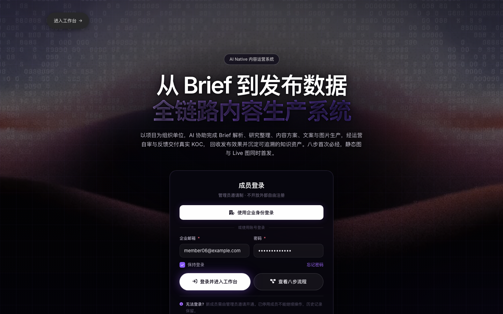
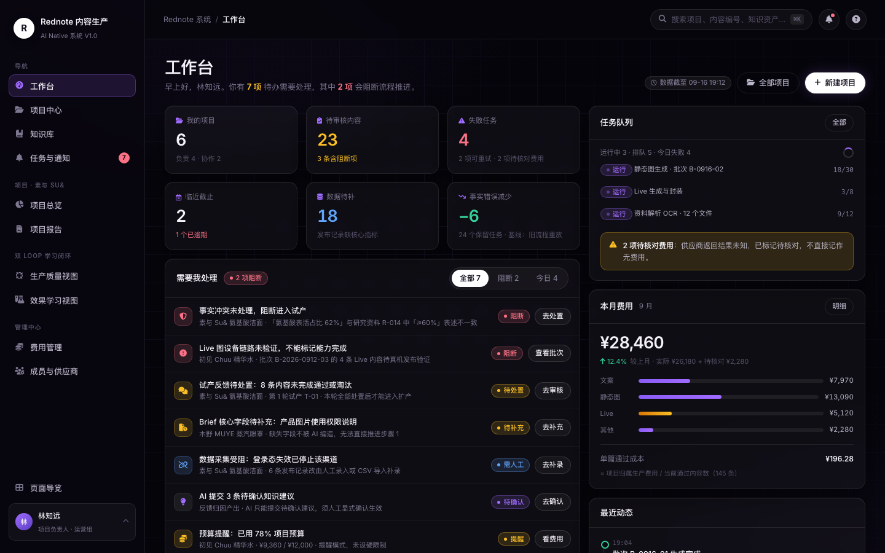
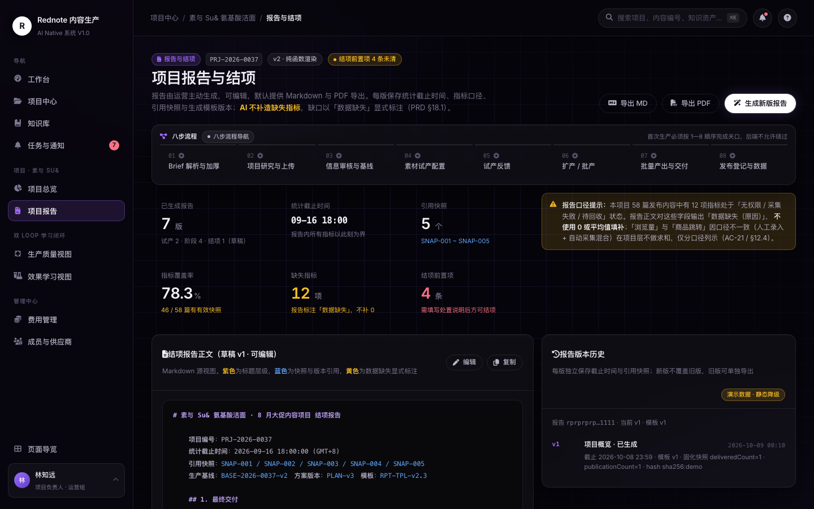

# 图文内容生产

[](https://github.com/lbh-banboo/tuwen-content-studio/actions/workflows/ci.yml) · [English](README.en.md)

[MIT](LICENSE) · `Python >= 3.12` · `FastAPI` · `PostgreSQL 17 + pgvector` · `v0.1.1`

面向图文内容生产全流程的 AI Native 系统 —— 后端服务与可交互前端原型，仓库标识 `tuwen-content-studio`。

> **English**: Tuwen Content Studio is a public source snapshot of an AI-Native image-text content workflow — FastAPI + SQLAlchemy/Alembic on PostgreSQL with pgvector, plus a build-free static demo. Research in progress, not a production-ready product.

## 界面预览

前端原型（`outputs/rednote-demo/`）的全部界面数据为 mock / 合成值：

**登录与页面导览**



**工作台 —— 项目、任务队列、费用与最近动态一屏总览**



**项目报告与结项 —— 八步流程视图与报告版本管理**



> **开源快照说明**：本仓库是脱敏后的公开源码快照，不含原研发历史与运行期数据。
> 所有示例账号、邮箱、路径、域名均已替换为虚构值；不包含任何真实业务数据、
> 账号登录凭证、浏览器 profile 或密钥。

## 项目状态

**这是一个研发中的项目，不是可直接上线的产品。** 请按下面这张表判断能用到哪一步。

| 项 | 状态 |
|---|---|
| 后端 | 模块化单体，FastAPI + SQLAlchemy 2 + PostgreSQL 17/pgvector + Alembic。M1~M5 分阶段交付，部分工作包仍在开发 |
| 前端 | `outputs/rednote-demo/` 是静态 HTML/JS 可交互原型，使用 mock / 合成数据 |
| 部署编排 | `deploy/dev/` 的 docker compose **未在开发者本机实跑验证**（本机无 Docker），需在具备 Docker 的环境验证 |
| 外部依赖 | 真实平台适配器、Live 环境、OIDC/Keycloak 等为**未验证**或占位实现，相关产出标记 `SYNTHETIC` / `PLACEHOLDER` |
| 测试 | `services/backend/tests/` 含单元与集成测试，需本地 PostgreSQL + pgvector |
| 文档 | `docs/` 含架构决策记录（ADR）、各阶段说明；`docs/DEVELOPMENT-NOTES.md` 是原内部研发台账，供了解设计取舍 |

不要把占位 / 未验证组件当成生产可用能力。

## 技术栈

- Python >= 3.12，FastAPI 0.115 / SQLAlchemy 2.0 / psycopg 3 / Alembic 1.18
- PostgreSQL 17 + pgvector 扩展（迁移会断言 `vector` 扩展已启用）
- 事件与任务：Outbox 事件表 + 任务租约 / 幂等记录；执行路径不依赖 MQ
- 可选基础设施：MinIO（S3 兼容）、RabbitMQ 4、Keycloak 26
- 前端：无构建步骤的原生 HTML/CSS/JS 原型

## 目录结构

| 路径 | 内容 |
|---|---|
| `services/backend/` | 后端源码（`src/rednote/`）、测试、`pyproject.toml` |
| `migrations/` | Alembic 迁移与 `alembic.ini` |
| `contracts/` | OpenAPI 契约 |
| `docs/` | ADR、各里程碑设计说明、研发过程台账 |
| `evidence/` | 工程判据的证据数据（执行日志未随开源发布） |
| `tools/` | 质量判据、数据种子、mock server、证据采集脚本 |
| `datasets/` `templates/` | 评测与模板样例 |
| `deploy/dev/` `deploy/prod/` | 开发与生产部署编排（生产编排为内网场景样例） |
| `outputs/rednote-demo/` | 前端静态原型 |

## 快速开始

### 前置

- Python >= 3.12
- PostgreSQL 17，且目标库已启用 `vector` 扩展
- （可选）Docker，用于 `deploy/dev/docker-compose.yml`

### 后端

```bash
python -m venv .venv
source .venv/bin/activate
pip install -e "./services/backend[dev]"

createdb rednote_dev
psql -d rednote_dev -c 'CREATE EXTENSION IF NOT EXISTS vector'

export REDNOTE_DATABASE_URL='postgresql+psycopg://postgres@localhost:5432/rednote_dev'
python -m alembic -c migrations/alembic.ini upgrade head
python -m uvicorn rednote.main:create_app --factory --app-dir services/backend/src --reload
```

健康检查：`GET /api/v1/health` 与 `GET /api/v1/health/db`。

### 测试

```bash
cd services/backend
python -m pytest
```

> `pyproject.toml` 的 `addopts` 已含 `-q`，命令行不要再传 `-q`（会叠加成 `-qq` 压掉汇总行）。
> 需要真实数据库时，用 `REDNOTE_TEST_DATABASE_URL` 指向独立库，避免并行任务互相污染。

### 前端原型

```bash
cd outputs/rednote-demo
python -m http.server 8080
# 浏览器打开本机 8080 端口的 index.html
```

纯静态，无需构建；页面数据为 mock。

## 配置

凭据一律经环境变量注入。仓库只含 `.env.example`，值全为 `CHANGE_ME_*` 占位：

- `services/backend/.env.example` — 应用与数据库
- `deploy/dev/.env.example` — 开发编排
- `deploy/prod/.env.example` — 生产编排样例（镜像引用需按 `images.lock.json` 回填）

**不要把真实口令写进 `.env` 并提交。**

## 关于数据

本快照不含真实用户数据、平台采集内容、账号 Cookie、浏览器 profile 或 CI/判据执行日志。
demo 中的 `@example.com` 邮箱、示例链接与占位 token 均为虚构值。
`docs/` 与 `evidence/` 保留了研发过程记录，这些是工程过程信息而非运行时数据。

## 安全

漏洞报告方式见 [SECURITY.md](SECURITY.md)。

## 贡献

见 [CONTRIBUTING.md](CONTRIBUTING.md) 与 [CODE_OF_CONDUCT.md](CODE_OF_CONDUCT.md)。

## 许可证

[MIT](LICENSE)
