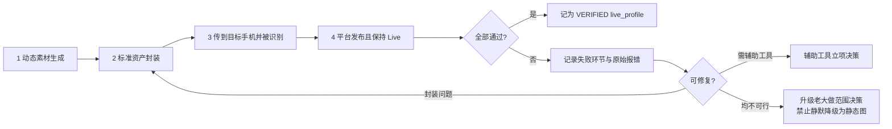

# WP02 · Live 封装技术规格（草案）

> 状态：**草案，待真机验证后修订**。本文是封装适配器的输入规格，不是已验证结论。
> 关联：`docs/m0/WP02-Live链路验证协议.md`、需求 §13.3、研发计划 01 §8

## 1. 术语与边界

| 术语 | 定义 |
|---|---|
| Live 资产 | 能在明确支持的设备链路上导入并**发布为平台 Live 图**的交付资产。**不等同于 GIF、不等于普通视频** |
| 静帧（still） | 封面帧，通常 JPG/HEIC |
| 动态资源（paired motion） | 与静帧配对的动态片段 |
| 封装 | 把静帧与动态资源按目标平台/设备可识别的方式组合并附加必要元数据 |
| 预览资产 | 供运营在浏览器/审核界面查看的替代品（可为短 MP4 或动图），**明确不是正式交付物** |

**禁止的推断**（研发计划 01 §8 已明确）：
> "浏览器下载两个文件即可自动成为 Live Photo" 是错误推断。Apple Live Photo 依赖静态图与配对视频资源的组合关系，Photos 框架提供的是组合资源的 API，不能据此认为任意两个文件放进相册就会被识别为实况。

## 2. 资产规格（待实测校准，当前为规划占位）

| 项 | 规划值 | 状态 |
|---|---|---|
| 静帧比例 | 竖版 3:4 | 与需求 §13.2 实施建议一致 |
| 静帧格式 | JPG / HEIC | `[待实测: 平台与设备对两种格式的接受度]` |
| 静帧尺寸 | `[待实测: 目标设备与平台的最佳尺寸]` | 不写死猜测值 |
| 动态时长 | `[待实测: 平台可接受范围]` | 影响封装与文件大小 |
| 动态编码 | `[待实测: 目标链路可识别的编码与容器]` | 决定 FFmpeg 参数 |
| 音频策略 | `[待实测: 是否允许/需要音频]` | 无声是否可用需验证 |
| 单组文件大小 | `[待实测]` | 影响批量交付包体积与传输耗时 |
| 批量交付 | ZIP 打包，解包后可逐个导入 | 需求 §11.3 已定 |

## 3. 组件模型（对应数据表 `media_components`）

| role | 说明 | 是否必需 |
|---|---|---|
| `ORIGINAL` | 供应商原始输出 | 是（留档与重封装） |
| `STILL` | 封装用静帧 | 是 |
| `PAIRED_MOTION` | 封装用动态资源 | 是 |
| `MANIFEST` | 配对/封装元数据文件 | 视目标链路要求 |
| `PREVIEW` | 审核用预览 | 是（内部审核用，不交付） |

**规则**：`media_versions` 标记为 `LIVE` 时，必须关联完整组成文件与**已验证的格式配置**（`live_profiles`），否则不得进入正式交付（需求 §13.3）。

## 4. 封装流程（四环节，任一失败即整体不可用）



## 5. 封装适配器接口（内部服务协议，对应文档 03 §12.2）

```typescript
type LivePackRequest = {
  requestId: string;
  jobId: string;
  stillFileId: string;
  motionFileId: string;
  liveProfileId: string;        // 绑定已验证的格式配置
  coverTimestampMs: number;     // 封面帧取点
  audioPolicy: 'NONE' | 'KEEP' | 'STRIP';
};

type LivePackResult = {
  state: 'SUCCEEDED' | 'FAILED' | 'UNKNOWN';
  mediaVersionId: string | null;
  componentFileIds: string[];   // 按 role 组织
  previewFileId: string | null;
  metadataValidation: 'PASS' | 'FAIL';
  compatibilityProfileVersion: string;
  errorCode: string | null;
};
```

**关键约束**：
- `metadataValidation = PASS` **只表示文件结构检查通过，不替代首次真机发布认证**（文档 03 §12.2 原文要求）。
- 供应商只输出动态片段时，系统必须完成可发布格式封装，**不得把这一步留给运营自行研究**（需求 §13.3）。

## 6. 存储与生命周期

| 资产 | 保存位置 | 是否进正式交付包 |
|---|---|---|
| 供应商原始输出 | `ORIGINAL` | 否 |
| 封装结果（静帧+动态+元数据） | 正式资产 | 是 |
| 浏览器预览 | `PREVIEW` | **否**（明确标注预览用途） |
| 真机验证记录 | 验证档案 | 否（验收证据） |

**红线**：Live 文件不得仅导出预览视频代替正式交付格式（需求 §11.3）。

## 7. 验证记录要求（P0 输出，对应研发计划 01 §8.1）

必须产出：
1. 目标设备、系统及平台版本矩阵；
2. 封面静帧、动态资源、标识及必要元数据的**兼容样本**；
3. 原始素材、封装结果、浏览器预览、最终交付**分别存储**的证据；
4. 单张、静态混合、批量 ZIP 解包的**真机测试记录**；
5. 运营可执行的**导入说明与耗时**。

## 8. 待实测清单（G0-05~G0-09 的判据来源）

| # | 待测项 | 判据 |
|---|---|---|
| 1 | 静帧格式接受度（JPG vs HEIC） | 相册识别为实况 |
| 2 | 动态编码与容器 | 相册可播放动态 |
| 3 | 配对元数据写入方式 | 相册显示"实况"角标 |
| 4 | 音频策略 | 平台发布后是否保留 |
| 5 | 传输路径（AirDrop / iCloud / 其他） | 识别率与耗时 |
| 6 | 批量 ZIP 解包导入 | 抽查 3 张可发布 |
| 7 | 发布后他人视角 | 观看者可见实况效果 |
| 8 | 系统/App 升级影响 | 升级后需重测，故 `live_profiles` 版本化 |

## 9. 失败处置（对应 WP02 协议 §7）

1. 先判定是否属封装格式可修复问题 → 修封装再测一轮；
2. 仍失败 → 评估自研辅助导入工具（须回答签名与分发是否具备、企业是否批准）；
3. 工具不可行 → **Live 硬要求未达**，升级老大做范围决策；
4. **全程禁止**默认降级为静态图并宣称已完成（需求 §13.3 明确禁止静默降级）。
